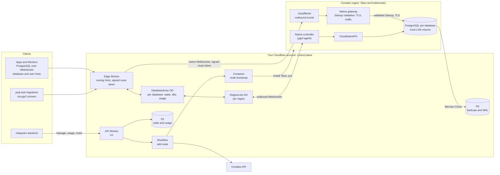
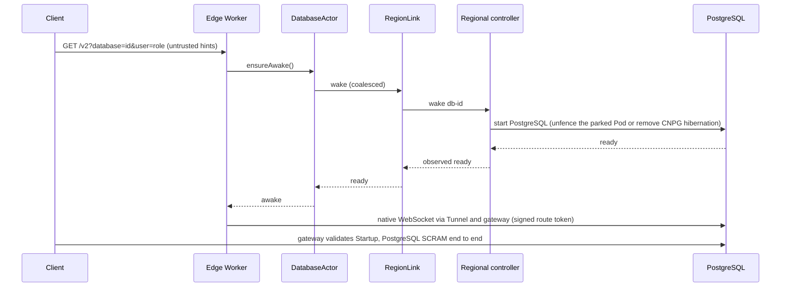

# cloudflare-postgres

Open-source, Neon-style serverless PostgreSQL that runs on **your Cloudflare account** and **your
Contabo VPS**. Cloudflare runs the whole control plane and is the only way into the databases.
The VPS run real, unmodified PostgreSQL under CloudNativePG. The current deployment is EU only:
the EU control/relay VPS and the already-admitted EU customer worker **EU1** (formerly EU2), a
Contabo Cloud VPS with **6 vCPU and 12 GB RAM**. EU1 keeps its existing installation, identity
and data. The US region was cancelled and its server marked lost on 2026-10-11; US and Oceania
return later from the same per-region configuration. System and platform resources remain
protected; server loss is recovered from R2.

- Create, resize, suspend, restore and delete databases through a versioned API.
- Connect through Cloudflare: PostgreSQL over WebSocket. The VPS expose no database port.
- Databases sleep when idle and wake on the next connection.
- Continuous backups to R2 with point-in-time recovery.
- Usage and infrastructure-cost metrics per database. You put your own pricing on top.
- Capacity placement and Contabo provisioning are implemented; purchases stay off until the operator enables them, and the fully automatic node addition has not been accepted on a genuine purchase.

Integrators keep their adapters and any tooling that moves their existing databases in their own
repositories; the [integrator handover](docs/operations/integrator-handover.md) describes the API,
connections and limits they build on.

## Status

The [ULTRA plan](docs/architecture/cloudflare-convergence-and-serverless-plan.md) is the canonical
record of scope, measured results ([Done](docs/architecture/cloudflare-convergence-and-serverless-plan.md#done)),
the [go-live path](docs/architecture/cloudflare-convergence-and-serverless-plan.md#go-live-path) and
the work that follows ([after go-live](docs/architecture/cloudflare-convergence-and-serverless-plan.md#after-go-live)).
The first integrator creates its new databases on PGCF once that path is complete. This README
states what runs where; it does not repeat measurements.

| Part                                             | State on the EU fleet                                                                                                                                  |
| ------------------------------------------------ | ------------------------------------------------------------------------------------------------------------------------------------------------------ |
| API Worker, DatabaseActor, RegionLink, Workflows | TypeScript on Cloudflare, deployed; they remain TypeScript                                                                                             |
| Edge Worker                                      | TypeScript (`apps/edge`) is deployed; the Rust/Wasm replacement (`apps/edge-rust`) is built by CI and not deployed                                     |
| Regional controller                              | Native Rust (`apps/native-controller`, Deployment `pgcf-agent`), deployed                                                                              |
| Regional gateway                                 | Native Rust (`apps/native-gateway`, Deployment `pgcf-gateway`), deployed                                                                               |
| Bootstrap relay (EU control only)                | TypeScript (`apps/regional`) is deployed; the native replacement (`apps/native-bootstrap-relay`) is built and not deployed                             |
| Database storage                                 | New databases use Thin LVM volumes on EU1; retained thick volumes keep their backend and data                                                          |
| Idle sleep                                       | CNPG hibernation; the [parked sleep tier](docs/architecture/parked-instances.md) is implemented and the region policy `parked_tier` is its only switch |

The actual-RAM expansion threshold and automatic-purchase switch are operator settings exposed
through the authenticated management API. Expansion requires ten fresh aligned consecutive
minutes from every eligible customer node, each retaining its own Node UID. Existing capacity
remains eligible during rollout under hard RAM, CPU, storage and full PostgreSQL/Barman
startup-peak guards; there is no 81% placement cutoff. Missing observations remain unknown. Fresh
installations do not purchase automatically or send notifications, and this installation keeps
purchases and autoscale off. An optional `max_nodes` limit can be removed with `null`; no fixed
three-node ceiling is required. Monetary and lifetime order-count ceilings are optional under
explicit operator authority.

## Architecture

The programmed installer selects a provider-verified source once and retains its association in
Cloudflare across proof renewals. Renewed claims are short-lived; current job/binding authority,
host keys, TLS, Cluster UID, Node UID and fresh native identity readbacks still fence execution.
Kubernetes/Talos commands, transport grants and proof cleanup must make zero Contabo calls.
Contabo remains at purchase, initial inventory/firewall/rescue, hypervisor and uncertain-provider
resolution boundaries, including fresh verification before the first destructive write. Its
credential-scoped client reuses and coalesces OAuth until early expiry or 401 invalidation;
credential changes replace the client. Uncertain mutations are never replayed. The
[operator installation runbook](docs/operations/operator-installation.md) states the sequence.



Connecting to a sleeping database (the idle sleep is CNPG hibernation, or the parked tier when the
region policy enables it):



| Part                  | Where                | Job                                                                                                          |
| --------------------- | -------------------- | ------------------------------------------------------------------------------------------------------------ |
| API Worker            | Cloudflare           | `/v1` API, D1 state, Durable Objects, Workflows, usage rollups                                               |
| Edge Worker           | Cloudflare           | Database endpoint: Actor admission, wake, signed route, native forwarding                                    |
| Regional controller   | Kubernetes           | Native Rust (`pgcf-agent`): reconciles databases into CNPG resources; sleep/wake; reports status and samples |
| Gateway + cloudflared | Kubernetes           | Native Rust gateway: entry from Cloudflare; startup validation before PostgreSQL dial, TLS, stream counters  |
| Node bootstrap        | Cloudflare Container | Turns a Contabo VPS into a Talos node                                                                        |
| Platform              | Kubernetes (Flux)    | Cilium, OpenEBS LocalPV LVM, cert-manager, CloudNativePG, Barman Cloud plugin                                |

The approved client endpoint is `GET /v2?database=<id>&user=<role>` on the single database hostname.
Configure the Neon serverless driver's `Pool`/`Client` WebSocket mode with `pipelineConnect=false`
and a `wsProxy` URL containing both URL-encoded hints. Requests to the bare `/v2` endpoint or with
missing or invalid hints are unsupported. Actor admission checks the database and role against D1.
The Edge signs a route token that lives 30 seconds and names the database, role, region, database
generation and verified primary Pod (v3; v4 adds the admission route revision), and returns the
unopened upstream WebSocket for native forwarding. Admission failures return a small failure-only
`101` WebSocket carrying a PostgreSQL SQLSTATE error before any gateway upgrade or PostgreSQL dial.
Dev uses a VPC HTTP service with native forwarding; VPC TCP raw streams were unsuitable, and a
signed Tunnel route is the fallback.

The gateway checks the actual PostgreSQL StartupMessage database and user against the signed
route before opening PostgreSQL. It owns SSL/GSS preludes, CancelRequest, startup parsing and the
startup deadline, negotiates verified TLS to PostgreSQL, and measures stream bytes and connection
events. SCRAM authentication runs end to end with PostgreSQL; uncertain writes are never replayed.

### PostgreSQL tools

Build the CLI from this checkout with `pnpm --filter @pgcf/cli build`, then run:

```sh
node packages/cli/dist/main.js connect --endpoint wss://db.example.com --database <db-id> --user app
```

Use the printed loopback port in psql or migration tools, with `host=127.0.0.1`, your database
and user, and `sslmode=disable`. Enter the password in the PostgreSQL tool. The local hop is
plaintext; the public hop uses verified WSS and the gateway verifies PostgreSQL TLS. The CLI
adapts only the SASL mechanism offer to plain SCRAM for libpq compatibility; channel binding
requiring direct PostgreSQL TLS is unsupported. It never retries SQL. Limits are 16 local
connections, 1 MiB per WebSocket message and a bounded 10-second FIN grace (at most 20 seconds
during upstream startup). The packaged CLI includes the first-party and bundled-library licenses.

## Self-hosting requirements

- A Cloudflare account on the Workers Paid plan, with a zone that hosts one endpoint hostname
  (`db.example.com`): Workers, D1, Durable Objects, Workflows, R2, Tunnel and Containers.
- A Contabo account with API credentials. EU1 is a Cloud VPS with 6 vCPU and 12 GB RAM.

The current target is the operator deployment on existing accounts: one EU control server and
customer EU1. Each further region adds one control server and customer workers from the same
[delivery architecture](docs/architecture/cloudflare-convergence-and-serverless-plan.md#delivery-architecture).
Public-release installation polish follows separately; see [after go-live](docs/architecture/cloudflare-convergence-and-serverless-plan.md#after-go-live) in the ULTRA plan.

The management API reference is generated at `/v1/openapi.json` from the shared contracts,
including the public raw fleet-image GET/HEAD service. Regional controller operations are published
at `/agent/v1/openapi.json`; operation callbacks and relays are published at
`/internal/v1/openapi.json`. Each document contains only its interface and referenced schemas.
Their `info.version` is the request-serving Worker's version ID; `info.x-worker-version` also
includes its tag and timestamp. Configure the `CF_VERSION_METADATA` version metadata binding
shown in the example Worker configuration. If it is missing, reference requests return an
explicit internal error rather than a made-up version. Operator runbooks
cover [installation](docs/operations/operator-installation.md), [recovery](docs/operations/recovery.md)
and [credential changes](docs/operations/credentials.md).

The small TypeScript management client uses these same request and response contracts:

```ts
import { PgcfClient } from "@pgcf/contracts/client";

const client = new PgcfClient({
  baseUrl: process.env.PGCF_API_URL!,
  apiKey: process.env.PGCF_API_KEY!,
});
const restored = await client.restoreDatabase(sourceId,
  { mode: "full", name: "recovered" }, logicalOperationKey);
```

Keep `logicalOperationKey` stable for retries of that management operation. The client does not
retry uncertain writes or expose server response bodies in errors. PostgreSQL client pooling
remains the integrator's responsibility.

### Optional infrastructure notifications

Warnings are disabled by default. Use authenticated
`PUT /v1/regions/{region_id}/capacity-policy` to set `ram_warning_threshold_ppm` to the desired
parts-per-million RAM threshold (for example, `800000` means 80%). Set it to `null` to disable
RAM warnings. A cap notice additionally requires both a finite `max_nodes` and
`cap_warning_enabled: true`; set the flag to `false` to disable it. RAM warnings use the same
fresh, complete ten-minute regional measurements as capacity decisions.

Per-node warnings use the same route and scale: `node_ram_warning_threshold_ppm`,
`node_cpu_warning_threshold_ppm` and `node_storage_warning_threshold_ppm` each take an integer
from `1` to `1000000` parts per million (`900000` means 90%). `null` disables a warning; omitting
a field keeps its stored value. A warning fires when any single node reaches its threshold,
including a control node closed to database placement:

- RAM uses the node's own fresh, complete ten-minute working-set window.
- CPU averages kubelet CPU usage over the same ten consecutive minutes against the node's CPU
  capacity. Only regional reporters that send the optional CPU fields with their node memory
  samples supply it (the native controller); without them CPU stays unknown and never warns.
- Storage uses the node's fresh LVM sample: the fuller of thin-pool data and metadata when a thin
  pool exists, otherwise volume-group allocation.

Each region keeps one episode per kind (`regional_node_ram_warning`, `regional_node_cpu_warning`,
`regional_node_storage_warning`). Its event lists up to 64 exceeding nodes, highest first, with
`threshold_ppm` and the highest `utilization_ppm`. Another node crossing sends nothing new only
while a listed node still exceeds; otherwise the crossing replaces the episode with a new event.
The episode clears only after every listed node is fresh and below the threshold, or lost; a
missing measurement keeps it.

Fixed-rule alarms need no threshold and are evaluated for every region: a stale or lost node, a
failing or stale daily infrastructure backup, a running database whose WAL archive is failing
(`database_archive_failing`), an awake database with no completed base backup within 36 hours of
awake time (`database_base_backup_stale`; hibernated databases are excluded), a blocked Thin
storage node (`thin_storage_blocked`) and a database held in a protective stop for five minutes
(`database_storage_protected`). Each minute-cron step runs in its own failure boundary, and the
`CronWatchdog` Durable Object (binding `CRON_WATCHDOG`) judges the cron's heartbeat from its own
alarm, independently of the cron trigger, raising `control_cron_stalled` and
`control_cron_step_failing`. Every event carries a short runbook `action`; the
[alert runbook](docs/operations/infrastructure-backups.md#alert-kinds-and-runbook-actions)
lists each kind's rule and action.

Configure either an `INFRASTRUCTURE_ALERT_WEBHOOK` service binding or an HTTPS
`INFRASTRUCTURE_ALERT_WEBHOOK_URL`, plus your own `INFRASTRUCTURE_ALERT_WEBHOOK_TOKEN` secret.
The adopter's receiving service verifies the bearer token and durably deduplicates the
`event_id` / `Idempotency-Key` together with the exact request body before acknowledging it.
That service may use any mail provider. Alternatively, import `RESEND_API_KEY` as a private
Worker secret and configure `notification_sender` and `notification_recipient` through
`PUT /v1/infrastructure-backups/config`. The sender must belong to your verified Resend domain.
PGCF supplies no default recipient, sender or mail-provider credentials; a configured webhook
takes precedence over direct email.

PGCF retries an unacknowledged event with its original ID and body, at least 60 seconds apart,
with a five-second callback deadline. A successful callback records acceptance by the receiving
service or Resend API; final inbox delivery is observed in the operator's mail account. Inspect
event status through
`GET /v1/operational-health?scope=regions`. Disabling a warning deactivates its pending episode;
current warning policy and measurements are checked before delivery. Missing delivery
configuration does not block capacity decisions. Daily encrypted D1 and regional etcd backups,
full R2 readback, failure/staleness alarms and offline key custody are described in the
[infrastructure backup runbook](docs/operations/infrastructure-backups.md). Capture is disabled
by default until the operator supplies its actual D1 identity, export secret and Workflow binding.

## Development checks

CI and native Linux preflight use the same toolchain guard. `ciToolchain` in
[versions.lock.json](infra/platform/versions.lock.json) pins Node, Docker client/server, Buildx,
Ubuntu and the Rust targets; the existing `nativeRuntime.rustVersion` and `packageManager` remain
the Rust and pnpm authorities. Install those versions on the native Ubuntu AMD64 host, then run:

```sh
node scripts/ci/toolchain.mjs node-version
node scripts/ci/toolchain.mjs check-rust
```

The guard checks the actual host, Docker daemon, tool versions and installed Rust targets before
checks/builds. An unsupported environment stops with a named reason; it is not retried or accepted
as equivalent. Passing this guard establishes toolchain compatibility, not a passing build or
native/live acceptance. The single CI workflow contains the subsequent check/build commands.

The native configuration test requires the Talos client selected by `bootstrapClients.talos`
in [versions.lock.json](infra/platform/versions.lock.json). Download the entry for your operating
system/architecture from its pinned URL and verify its SHA-256 before execution:

```sh
export PGCF_TEST_TALOSCTL=/absolute/path/to/verified/talosctl
CI=true pnpm test
```

CI downloads and verifies its Linux client before running this test. Missing native test
configuration fails explicitly. Unit tests do not replace the live acceptance recorded in the ULTRA plan.

## Documents

- [PLAN.md](PLAN.md): entry point to the ULTRA plan: scope, delivery architecture, Done and Open
  status and the go-live path.
- [Rust runtime and cold starts](docs/architecture/rust-runtime-and-cold-starts.md): the native
  runtime architecture, verified routing and the cold-start design.
- [Parked sleep tier](docs/architecture/parked-instances.md): the idle sleep that keeps the
  instance Pod and stops only PostgreSQL.
- [Integrator handover](docs/operations/integrator-handover.md): the model, lifecycle API, client
  behaviour, limits, metering and recovery for an integrator that creates databases on PGCF.
- [Source-backed diagrams](docs/architecture/mermaider/README.md): declared Cloudflare resources,
  CI dependencies, current core D1 tables and the reviewed AddNode orchestration.
- [AGENTS.md](AGENTS.md): contributor and coding-agent brief.
- [THIRD_PARTY.md](THIRD_PARTY.md): upstream components and licenses.
- [infra/](infra/README.md): Talos, platform and backup recipes.
- [Native external probe](docs/operations/native-external-probe.md): the independent TCP/25 check
  that Cloudflare Workers cannot perform, and the full IPv4 port scan from a native runner,
  including provenance verification and cleanup.

## License

Original code and documentation: [Apache License 2.0](LICENSE). Third-party components keep their
own licenses. This is an independent project, not affiliated with Cloudflare, Contabo, Neon,
Supabase or CloudNativePG.
