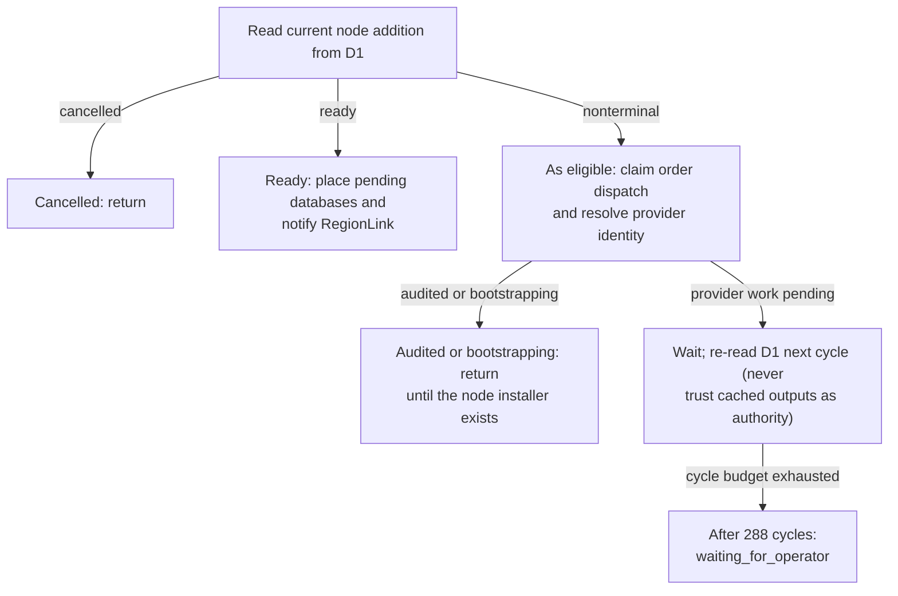

# AddNode orchestration overview from implemented source

Generated by Mermaider. View: **implemented**. Basis: **agent-reviewed semantic model**.

## Sources

- [apps/api/src/domain/node-capacity.ts · placePendingDatabases:36](../../../apps/api/src/domain/node-capacity.ts#L36)
- [apps/api/src/domain/node-state.ts · claimNodeDispatch:752](../../../apps/api/src/domain/node-state.ts#L752)
- [apps/api/src/domain/node-state.ts · recordNodeAudit:890](../../../apps/api/src/domain/node-state.ts#L890)
- [apps/api/src/workflows/add-node.ts · dispatchNodeOrder:67](../../../apps/api/src/workflows/add-node.ts#L67)
- [apps/api/src/workflows/add-node.ts · reconcileNodeProvider:110](../../../apps/api/src/workflows/add-node.ts#L110)
- [apps/api/src/workflows/add-node.ts · AddNode:211](../../../apps/api/src/workflows/add-node.ts#L211)

Freshness checks confirm the recorded source evidence and generated output. They do not establish live deployment or prove every semantic interpretation.
