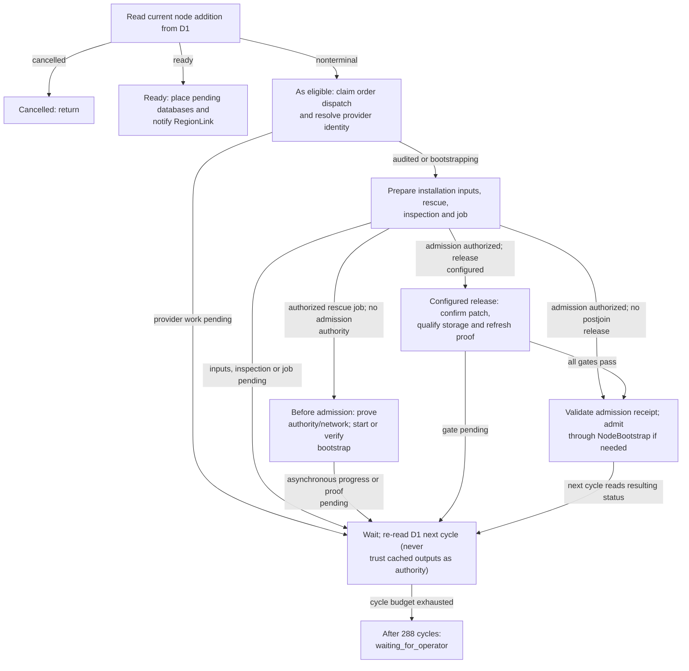

# AddNode orchestration overview from implemented source

Generated by Mermaider. View: **implemented**. Basis: **agent-reviewed semantic model**.

## Sources

- [apps/api/src/domain/bootstrap-composition.ts · composeConfiguredNodeBootstrap:71](../../../apps/api/src/domain/bootstrap-composition.ts#L71)
- [apps/api/src/domain/bootstrap-jobs.ts · bootstrapJobInput:111](../../../apps/api/src/domain/bootstrap-jobs.ts#L111)
- [apps/api/src/domain/bootstrap-jobs.ts · finalizeNodeAdmission:1524](../../../apps/api/src/domain/bootstrap-jobs.ts#L1524)
- [apps/api/src/domain/fleet-patches.ts · ensureBootstrapFleetPatch:1386](../../../apps/api/src/domain/fleet-patches.ts#L1386)
- [apps/api/src/domain/node-capacity.ts · placePendingDatabases:68](../../../apps/api/src/domain/node-capacity.ts#L68)
- [apps/api/src/domain/node-inspection.ts · ensureNodeInstallationInspection:574](../../../apps/api/src/domain/node-inspection.ts#L574)
- [apps/api/src/domain/node-proof.ts · ensureNodePreparationProof:23](../../../apps/api/src/domain/node-proof.ts#L23)
- [apps/api/src/domain/node-proof.ts · ensureNodeVerificationProof:75](../../../apps/api/src/domain/node-proof.ts#L75)
- [apps/api/src/domain/node-state.ts · claimNodeDispatch:762](../../../apps/api/src/domain/node-state.ts#L762)
- [apps/api/src/domain/node-thin-storage-bootstrap.ts · ensureBootstrapThinStorage:24](../../../apps/api/src/domain/node-thin-storage-bootstrap.ts#L24)
- [apps/api/src/domain/prepare-node-installation.ts · prepareNodeInstallationInputs:17](../../../apps/api/src/domain/prepare-node-installation.ts#L17)
- [apps/api/src/workflows/add-node.ts · dispatchNodeOrder:93](../../../apps/api/src/workflows/add-node.ts#L93)
- [apps/api/src/workflows/add-node.ts · reconcileNodeProvider:142](../../../apps/api/src/workflows/add-node.ts#L142)
- [apps/api/src/workflows/add-node.ts · ensureNodeRescue:243](../../../apps/api/src/workflows/add-node.ts#L243)
- [apps/api/src/workflows/add-node.ts · ensureBootstrapNetworkBoundary:378](../../../apps/api/src/workflows/add-node.ts#L378)
- [apps/api/src/workflows/add-node.ts · AddNode:418](../../../apps/api/src/workflows/add-node.ts#L418)

Freshness checks confirm the recorded source evidence and generated output. They do not establish live deployment or prove every semantic interpretation.
