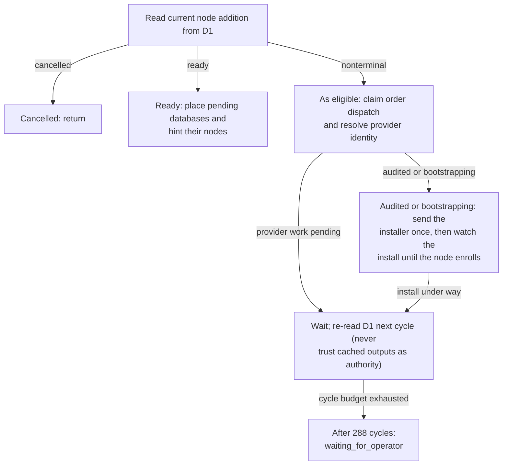

# AddNode orchestration overview from implemented source

Generated by Mermaider. View: **implemented**. Basis: **agent-reviewed semantic model**.

## Sources

- [apps/api/src/domain/node-capacity.ts · placePendingDatabases:37](../../../apps/api/src/domain/node-capacity.ts#L37)
- [apps/api/src/domain/node-installer.ts · driveNodeInstall:250](../../../apps/api/src/domain/node-installer.ts#L250)
- [apps/api/src/domain/node-state.ts · claimNodeDispatch:764](../../../apps/api/src/domain/node-state.ts#L764)
- [apps/api/src/workflows/add-node.ts · dispatchNodeOrder:69](../../../apps/api/src/workflows/add-node.ts#L69)
- [apps/api/src/workflows/add-node.ts · reconcileNodeProvider:112](../../../apps/api/src/workflows/add-node.ts#L112)
- [apps/api/src/workflows/add-node.ts · AddNode:213](../../../apps/api/src/workflows/add-node.ts#L213)

Freshness checks confirm the recorded source evidence and generated output. They do not establish live deployment or prove every semantic interpretation.
