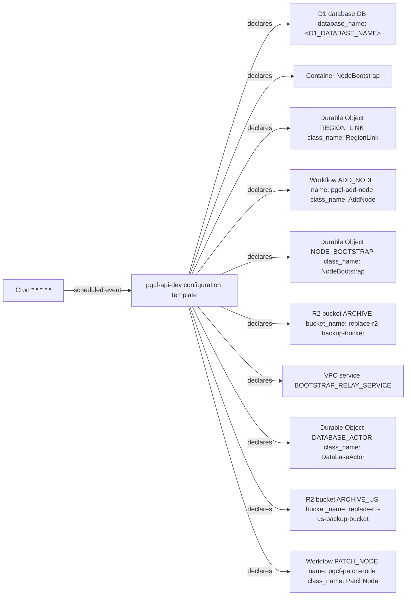

# Management API: declared Cloudflare resources (template)

Generated by Mermaider. View: **implemented**. Basis: **declared source structure**.

## Coverage notes

- **wrangler-placeholder**: Resource at d1_databases.0 contains a placeholder; its deployed target is unknown.

## Sources

- [apps/api/wrangler.example.jsonc:3](../../../apps/api/wrangler.example.jsonc#L3)
- [apps/api/wrangler.example.jsonc:7](../../../apps/api/wrangler.example.jsonc#L7)
- [apps/api/wrangler.example.jsonc:15](../../../apps/api/wrangler.example.jsonc#L15)
- [apps/api/wrangler.example.jsonc:20](../../../apps/api/wrangler.example.jsonc#L20)
- [apps/api/wrangler.example.jsonc:26](../../../apps/api/wrangler.example.jsonc#L26)
- [apps/api/wrangler.example.jsonc:57](../../../apps/api/wrangler.example.jsonc#L57)
- [apps/api/wrangler.example.jsonc:58](../../../apps/api/wrangler.example.jsonc#L58)
- [apps/api/wrangler.example.jsonc:59](../../../apps/api/wrangler.example.jsonc#L59)
- [apps/api/wrangler.example.jsonc:68](../../../apps/api/wrangler.example.jsonc#L68)
- [apps/api/wrangler.example.jsonc:77](../../../apps/api/wrangler.example.jsonc#L77)
- [apps/api/wrangler.example.jsonc:82](../../../apps/api/wrangler.example.jsonc#L82)
- [apps/api/wrangler.example.jsonc:84](../../../apps/api/wrangler.example.jsonc#L84)

Freshness checks confirm the recorded source evidence and generated output. They do not establish live deployment or prove every semantic interpretation.
