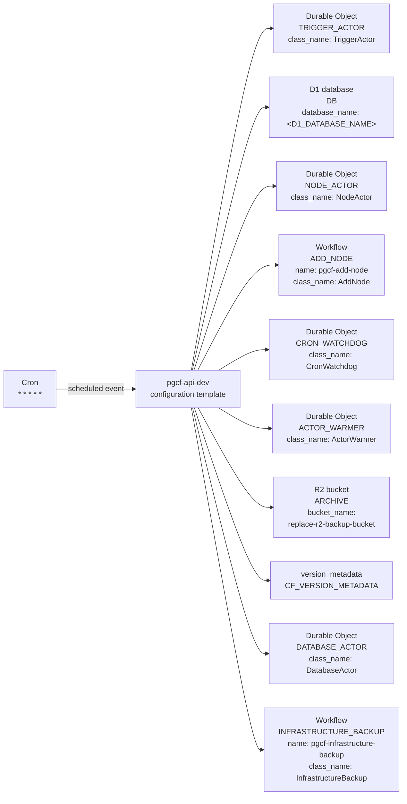

# Management API: declared Cloudflare resources (template)

Generated by Mermaider. View: **implemented**. Basis: **declared source structure**.

## Coverage notes

- **wrangler-placeholder**: Resource at d1_databases.0 contains a placeholder; its deployed target is unknown.

## Sources

- [apps/api/wrangler.example.jsonc:3](../../../apps/api/wrangler.example.jsonc#L3)
- [apps/api/wrangler.example.jsonc:11](../../../apps/api/wrangler.example.jsonc#L11)
- [apps/api/wrangler.example.jsonc:13](../../../apps/api/wrangler.example.jsonc#L13)
- [apps/api/wrangler.example.jsonc:25](../../../apps/api/wrangler.example.jsonc#L25)
- [apps/api/wrangler.example.jsonc:91](../../../apps/api/wrangler.example.jsonc#L91)
- [apps/api/wrangler.example.jsonc:92](../../../apps/api/wrangler.example.jsonc#L92)
- [apps/api/wrangler.example.jsonc:96](../../../apps/api/wrangler.example.jsonc#L96)
- [apps/api/wrangler.example.jsonc:99](../../../apps/api/wrangler.example.jsonc#L99)
- [apps/api/wrangler.example.jsonc:102](../../../apps/api/wrangler.example.jsonc#L102)
- [apps/api/wrangler.example.jsonc:121](../../../apps/api/wrangler.example.jsonc#L121)
- [apps/api/wrangler.example.jsonc:126](../../../apps/api/wrangler.example.jsonc#L126)
- [apps/api/wrangler.example.jsonc:128](../../../apps/api/wrangler.example.jsonc#L128)

Freshness checks confirm the recorded source evidence and generated output. They do not establish live deployment or prove every semantic interpretation.
