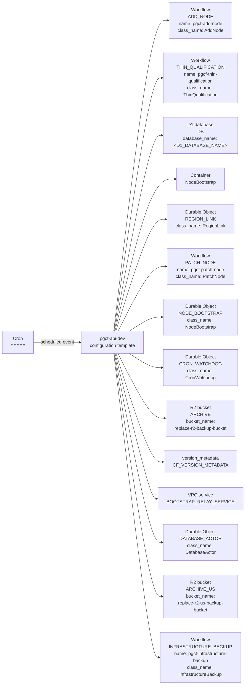

# Management API: declared Cloudflare resources (template)

Generated by Mermaider. View: **implemented**. Basis: **declared source structure**.

## Coverage notes

- **wrangler-placeholder**: Resource at d1_databases.0 contains a placeholder; its deployed target is unknown.

## Sources

- [apps/api/wrangler.example.jsonc:3](../../../apps/api/wrangler.example.jsonc#L3)
- [apps/api/wrangler.example.jsonc:6](../../../apps/api/wrangler.example.jsonc#L6)
- [apps/api/wrangler.example.jsonc:8](../../../apps/api/wrangler.example.jsonc#L8)
- [apps/api/wrangler.example.jsonc:16](../../../apps/api/wrangler.example.jsonc#L16)
- [apps/api/wrangler.example.jsonc:21](../../../apps/api/wrangler.example.jsonc#L21)
- [apps/api/wrangler.example.jsonc:27](../../../apps/api/wrangler.example.jsonc#L27)
- [apps/api/wrangler.example.jsonc:58](../../../apps/api/wrangler.example.jsonc#L58)
- [apps/api/wrangler.example.jsonc:59](../../../apps/api/wrangler.example.jsonc#L59)
- [apps/api/wrangler.example.jsonc:60](../../../apps/api/wrangler.example.jsonc#L60)
- [apps/api/wrangler.example.jsonc:63](../../../apps/api/wrangler.example.jsonc#L63)
- [apps/api/wrangler.example.jsonc:73](../../../apps/api/wrangler.example.jsonc#L73)
- [apps/api/wrangler.example.jsonc:83](../../../apps/api/wrangler.example.jsonc#L83)
- [apps/api/wrangler.example.jsonc:88](../../../apps/api/wrangler.example.jsonc#L88)
- [apps/api/wrangler.example.jsonc:93](../../../apps/api/wrangler.example.jsonc#L93)
- [apps/api/wrangler.example.jsonc:94](../../../apps/api/wrangler.example.jsonc#L94)
- [apps/api/wrangler.example.jsonc:100](../../../apps/api/wrangler.example.jsonc#L100)

Freshness checks confirm the recorded source evidence and generated output. They do not establish live deployment or prove every semantic interpretation.
