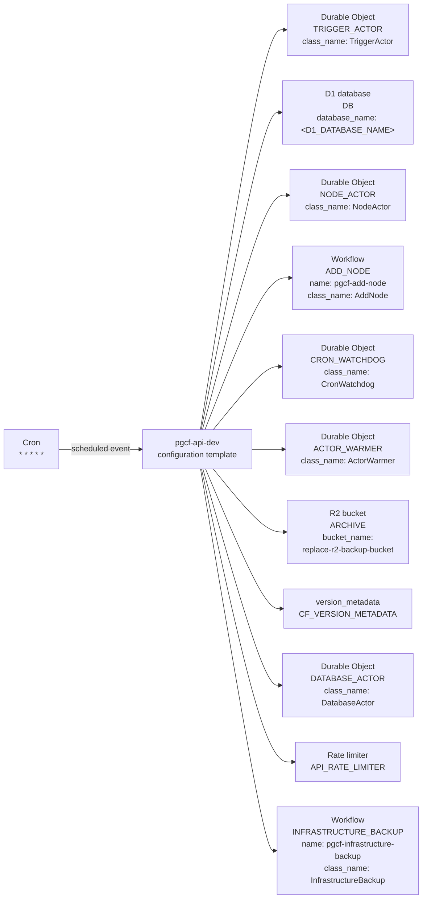

# Management API: declared Cloudflare resources (template)

Generated by Mermaider. View: **implemented**. Basis: **declared source structure**.

## Coverage notes

- **wrangler-placeholder**: Resource at d1_databases.0 contains a placeholder; its deployed target is unknown.

## Sources

- [apps/api/wrangler.example.jsonc:3](../../../apps/api/wrangler.example.jsonc#L3)
- [apps/api/wrangler.example.jsonc:12](../../../apps/api/wrangler.example.jsonc#L12)
- [apps/api/wrangler.example.jsonc:14](../../../apps/api/wrangler.example.jsonc#L14)
- [apps/api/wrangler.example.jsonc:26](../../../apps/api/wrangler.example.jsonc#L26)
- [apps/api/wrangler.example.jsonc:109](../../../apps/api/wrangler.example.jsonc#L109)
- [apps/api/wrangler.example.jsonc:120](../../../apps/api/wrangler.example.jsonc#L120)
- [apps/api/wrangler.example.jsonc:121](../../../apps/api/wrangler.example.jsonc#L121)
- [apps/api/wrangler.example.jsonc:125](../../../apps/api/wrangler.example.jsonc#L125)
- [apps/api/wrangler.example.jsonc:128](../../../apps/api/wrangler.example.jsonc#L128)
- [apps/api/wrangler.example.jsonc:131](../../../apps/api/wrangler.example.jsonc#L131)
- [apps/api/wrangler.example.jsonc:150](../../../apps/api/wrangler.example.jsonc#L150)
- [apps/api/wrangler.example.jsonc:155](../../../apps/api/wrangler.example.jsonc#L155)
- [apps/api/wrangler.example.jsonc:157](../../../apps/api/wrangler.example.jsonc#L157)

Freshness checks confirm the recorded source evidence and generated output. They do not establish live deployment or prove every semantic interpretation.
