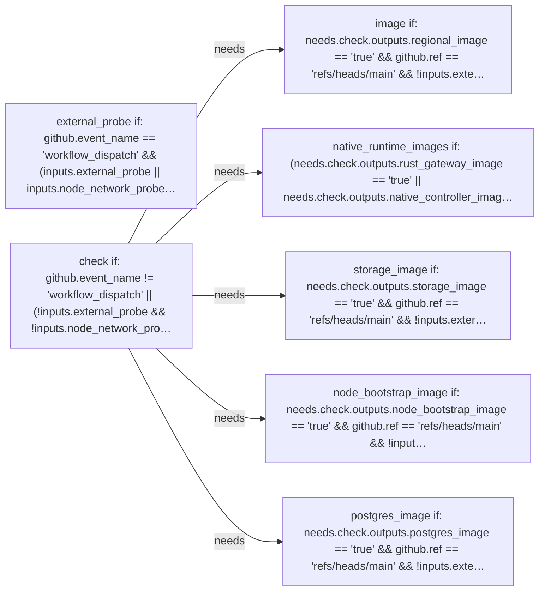

# PGCF CI: declared jobs and dependencies

Generated by Mermaider. View: **implemented**. Basis: **declared source structure**.

## Coverage notes

- **workflow-condition-detail**: Job check has a compacted condition label; exact condition from .github/workflows/ci.yml:28:
github.event_name != 'workflow_dispatch' || (!inputs.external_probe && !inputs.node_network_probe)
- **workflow-condition-detail**: Job external_probe has a compacted condition label; exact condition from .github/workflows/ci.yml:570:
github.event_name == 'workflow_dispatch' && (inputs.external_probe || inputs.node_network_probe) && github.ref == 'refs/heads/main' && github.event.repository.private == false
- **workflow-condition-detail**: Job image has a compacted condition label; exact condition from .github/workflows/ci.yml:231:
needs.check.outputs.regional_image == 'true' && github.ref == 'refs/heads/main' && !inputs.external_probe && !inputs.node_network_probe && (github.event_name == 'workflow_dispatch' || github.event_name == 'push')
- **workflow-condition-detail**: Job native_runtime_images has a compacted condition label; exact condition from .github/workflows/ci.yml:709:
(needs.check.outputs.rust_gateway_image == 'true' || needs.check.outputs.native_controller_image == 'true' || needs.check.outputs.rust_bootstrap_relay_image == 'true' || needs.check.outputs.native_reclaimer_image == 'true' || needs.check.outputs.sandbox_controller_image == 'true') && github.ref == 'refs/heads/main' && !inputs.external_probe && !inputs.node_network_probe && (github.event_name == 'workflow_dispatch' || github.event_name == 'push')
- **workflow-condition-detail**: Job node_bootstrap_image has a compacted condition label; exact condition from .github/workflows/ci.yml:345:
needs.check.outputs.node_bootstrap_image == 'true' && github.ref == 'refs/heads/main' && !inputs.external_probe && !inputs.node_network_probe && (github.event_name == 'workflow_dispatch' || github.event_name == 'push')
- **workflow-condition-detail**: Job postgres_image has a compacted condition label; exact condition from .github/workflows/ci.yml:459:
needs.check.outputs.postgres_image == 'true' && github.ref == 'refs/heads/main' && !inputs.external_probe && !inputs.node_network_probe && (github.event_name == 'workflow_dispatch' || github.event_name == 'push')
- **workflow-condition-detail**: Job storage_image has a compacted condition label; exact condition from .github/workflows/ci.yml:648:
needs.check.outputs.storage_image == 'true' && github.ref == 'refs/heads/main' && !inputs.external_probe && !inputs.node_network_probe && (github.event_name == 'workflow_dispatch' || github.event_name == 'push')

## Sources

- [.github/workflows/ci.yml:28](../../../.github/workflows/ci.yml#L28)
- [.github/workflows/ci.yml:230](../../../.github/workflows/ci.yml#L230)
- [.github/workflows/ci.yml:344](../../../.github/workflows/ci.yml#L344)
- [.github/workflows/ci.yml:458](../../../.github/workflows/ci.yml#L458)
- [.github/workflows/ci.yml:570](../../../.github/workflows/ci.yml#L570)
- [.github/workflows/ci.yml:647](../../../.github/workflows/ci.yml#L647)
- [.github/workflows/ci.yml:708](../../../.github/workflows/ci.yml#L708)

Freshness checks confirm the recorded source evidence and generated output. They do not establish live deployment or prove every semantic interpretation.
