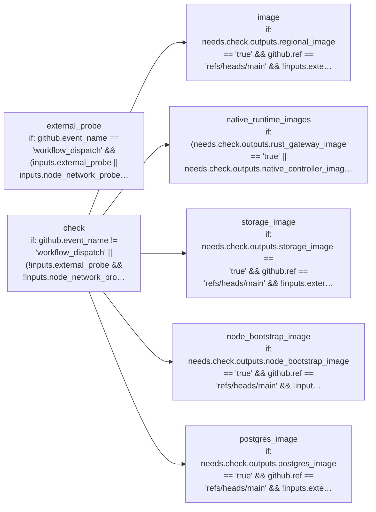

# PGCF CI: declared jobs and dependencies

Generated by Mermaider. View: **implemented**. Basis: **declared source structure**.

## Coverage notes

- **workflow-condition-detail**: Job check has a compacted condition label; exact condition from .github/workflows/ci.yml:28:
github.event_name != 'workflow_dispatch' || (!inputs.external_probe && !inputs.node_network_probe)
- **workflow-condition-detail**: Job external_probe has a compacted condition label; exact condition from .github/workflows/ci.yml:628:
github.event_name == 'workflow_dispatch' && (inputs.external_probe || inputs.node_network_probe) && github.ref == 'refs/heads/main' && github.event.repository.private == false
- **workflow-condition-detail**: Job image has a compacted condition label; exact condition from .github/workflows/ci.yml:282:
needs.check.outputs.regional_image == 'true' && github.ref == 'refs/heads/main' && !inputs.external_probe && !inputs.node_network_probe && (github.event_name == 'workflow_dispatch' || github.event_name == 'push')
- **workflow-condition-detail**: Job native_runtime_images has a compacted condition label; exact condition from .github/workflows/ci.yml:769:
(needs.check.outputs.rust_gateway_image == 'true' || needs.check.outputs.native_controller_image == 'true' || needs.check.outputs.rust_bootstrap_relay_image == 'true' || needs.check.outputs.native_reclaimer_image == 'true' || needs.check.outputs.sandbox_controller_image == 'true' || needs.check.outputs.pool_supervisor_image == 'true' || vars.PGCF_TALOS_INSTALLER_RELEASE != '') && github.ref == 'refs/heads/main' && !inputs.external_probe && !inputs.node_network_probe && (github.event_name == 'workflow_dispatch' || github.event_name == 'push')
- **workflow-condition-detail**: Job node_bootstrap_image has a compacted condition label; exact condition from .github/workflows/ci.yml:399:
needs.check.outputs.node_bootstrap_image == 'true' && github.ref == 'refs/heads/main' && !inputs.external_probe && !inputs.node_network_probe && (github.event_name == 'workflow_dispatch' || github.event_name == 'push')
- **workflow-condition-detail**: Job postgres_image has a compacted condition label; exact condition from .github/workflows/ci.yml:515:
needs.check.outputs.postgres_image == 'true' && github.ref == 'refs/heads/main' && !inputs.external_probe && !inputs.node_network_probe && (github.event_name == 'workflow_dispatch' || github.event_name == 'push')
- **workflow-condition-detail**: Job storage_image has a compacted condition label; exact condition from .github/workflows/ci.yml:706:
needs.check.outputs.storage_image == 'true' && github.ref == 'refs/heads/main' && !inputs.external_probe && !inputs.node_network_probe && (github.event_name == 'workflow_dispatch' || github.event_name == 'push')

## Sources

- [.github/workflows/ci.yml:28](../../../.github/workflows/ci.yml#L28)
- [.github/workflows/ci.yml:281](../../../.github/workflows/ci.yml#L281)
- [.github/workflows/ci.yml:398](../../../.github/workflows/ci.yml#L398)
- [.github/workflows/ci.yml:514](../../../.github/workflows/ci.yml#L514)
- [.github/workflows/ci.yml:628](../../../.github/workflows/ci.yml#L628)
- [.github/workflows/ci.yml:705](../../../.github/workflows/ci.yml#L705)
- [.github/workflows/ci.yml:768](../../../.github/workflows/ci.yml#L768)

Freshness checks confirm the recorded source evidence and generated output. They do not establish live deployment or prove every semantic interpretation.
