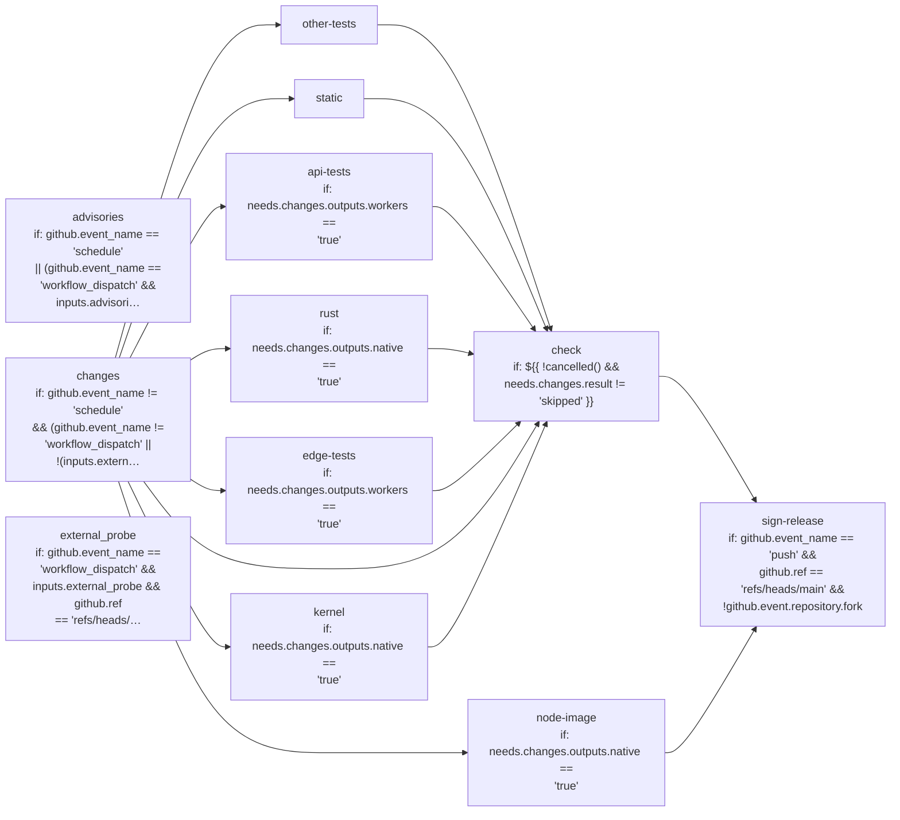

# PGCF CI: declared jobs and dependencies

Generated by Mermaider. View: **implemented**. Basis: **declared source structure**.

## Coverage notes

- **workflow-condition-detail**: Job advisories has a compacted condition label; exact condition from .github/workflows/ci.yml:641:
github.event_name == 'schedule' || (github.event_name == 'workflow_dispatch' && inputs.advisories)
- **workflow-condition-detail**: Job changes has a compacted condition label; exact condition from .github/workflows/ci.yml:34:
github.event_name != 'schedule' && (github.event_name != 'workflow_dispatch' || !(inputs.external_probe || inputs.advisories))
- **workflow-condition-detail**: Job external_probe has a compacted condition label; exact condition from .github/workflows/ci.yml:426:
github.event_name == 'workflow_dispatch' && inputs.external_probe && github.ref == 'refs/heads/main' && github.event.repository.private == false

## Sources

- [.github/workflows/ci.yml:34](../../../.github/workflows/ci.yml#L34)
- [.github/workflows/ci.yml:62](../../../.github/workflows/ci.yml#L62)
- [.github/workflows/ci.yml:120](../../../.github/workflows/ci.yml#L120)
- [.github/workflows/ci.yml:184](../../../.github/workflows/ci.yml#L184)
- [.github/workflows/ci.yml:286](../../../.github/workflows/ci.yml#L286)
- [.github/workflows/ci.yml:315](../../../.github/workflows/ci.yml#L315)
- [.github/workflows/ci.yml:362](../../../.github/workflows/ci.yml#L362)
- [.github/workflows/ci.yml:400](../../../.github/workflows/ci.yml#L400)
- [.github/workflows/ci.yml:426](../../../.github/workflows/ci.yml#L426)
- [.github/workflows/ci.yml:471](../../../.github/workflows/ci.yml#L471)
- [.github/workflows/ci.yml:584](../../../.github/workflows/ci.yml#L584)
- [.github/workflows/ci.yml:641](../../../.github/workflows/ci.yml#L641)

Freshness checks confirm the recorded source evidence and generated output. They do not establish live deployment or prove every semantic interpretation.
