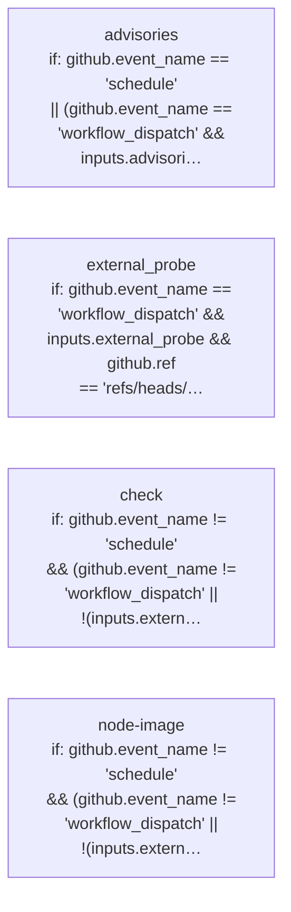

# PGCF CI: declared jobs and dependencies

Generated by Mermaider. View: **implemented**. Basis: **declared source structure**.

## Coverage notes

- **workflow-condition-detail**: Job advisories has a compacted condition label; exact condition from .github/workflows/ci.yml:368:
github.event_name == 'schedule' || (github.event_name == 'workflow_dispatch' && inputs.advisories)
- **workflow-condition-detail**: Job check has a compacted condition label; exact condition from .github/workflows/ci.yml:30:
github.event_name != 'schedule' && (github.event_name != 'workflow_dispatch' || !(inputs.external_probe || inputs.advisories))
- **workflow-condition-detail**: Job external_probe has a compacted condition label; exact condition from .github/workflows/ci.yml:215:
github.event_name == 'workflow_dispatch' && inputs.external_probe && github.ref == 'refs/heads/main' && github.event.repository.private == false
- **workflow-condition-detail**: Job node-image has a compacted condition label; exact condition from .github/workflows/ci.yml:260:
github.event_name != 'schedule' && (github.event_name != 'workflow_dispatch' || !(inputs.external_probe || inputs.advisories))

## Sources

- [.github/workflows/ci.yml:30](../../../.github/workflows/ci.yml#L30)
- [.github/workflows/ci.yml:215](../../../.github/workflows/ci.yml#L215)
- [.github/workflows/ci.yml:260](../../../.github/workflows/ci.yml#L260)
- [.github/workflows/ci.yml:368](../../../.github/workflows/ci.yml#L368)

Freshness checks confirm the recorded source evidence and generated output. They do not establish live deployment or prove every semantic interpretation.
