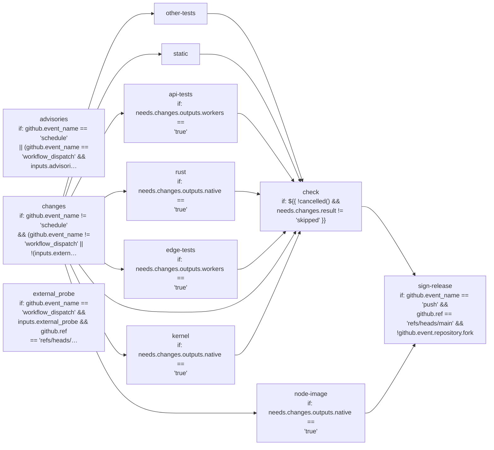

# PGCF CI: declared jobs and dependencies

Generated by Mermaider. View: **implemented**. Basis: **declared source structure**.

## Coverage notes

- **workflow-condition-detail**: Job advisories has a compacted condition label; exact condition from .github/workflows/ci.yml:659:
github.event_name == 'schedule' || (github.event_name == 'workflow_dispatch' && inputs.advisories)
- **workflow-condition-detail**: Job changes has a compacted condition label; exact condition from .github/workflows/ci.yml:34:
github.event_name != 'schedule' && (github.event_name != 'workflow_dispatch' || !(inputs.external_probe || inputs.advisories))
- **workflow-condition-detail**: Job external_probe has a compacted condition label; exact condition from .github/workflows/ci.yml:441:
github.event_name == 'workflow_dispatch' && inputs.external_probe && github.ref == 'refs/heads/main' && github.event.repository.private == false

## Sources

- [.github/workflows/ci.yml:34](../../../.github/workflows/ci.yml#L34)
- [.github/workflows/ci.yml:64](../../../.github/workflows/ci.yml#L64)
- [.github/workflows/ci.yml:130](../../../.github/workflows/ci.yml#L130)
- [.github/workflows/ci.yml:196](../../../.github/workflows/ci.yml#L196)
- [.github/workflows/ci.yml:297](../../../.github/workflows/ci.yml#L297)
- [.github/workflows/ci.yml:326](../../../.github/workflows/ci.yml#L326)
- [.github/workflows/ci.yml:373](../../../.github/workflows/ci.yml#L373)
- [.github/workflows/ci.yml:413](../../../.github/workflows/ci.yml#L413)
- [.github/workflows/ci.yml:441](../../../.github/workflows/ci.yml#L441)
- [.github/workflows/ci.yml:486](../../../.github/workflows/ci.yml#L486)
- [.github/workflows/ci.yml:598](../../../.github/workflows/ci.yml#L598)
- [.github/workflows/ci.yml:659](../../../.github/workflows/ci.yml#L659)

Freshness checks confirm the recorded source evidence and generated output. They do not establish live deployment or prove every semantic interpretation.
