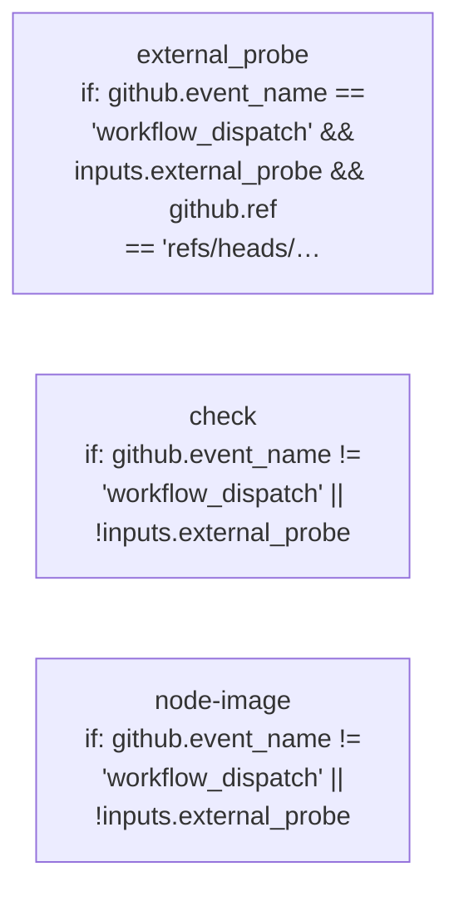

# PGCF CI: declared jobs and dependencies

Generated by Mermaider. View: **implemented**. Basis: **declared source structure**.

## Coverage notes

- **workflow-condition-detail**: Job external_probe has a compacted condition label; exact condition from .github/workflows/ci.yml:209:
github.event_name == 'workflow_dispatch' && inputs.external_probe && github.ref == 'refs/heads/main' && github.event.repository.private == false

## Sources

- [.github/workflows/ci.yml:24](../../../.github/workflows/ci.yml#L24)
- [.github/workflows/ci.yml:209](../../../.github/workflows/ci.yml#L209)
- [.github/workflows/ci.yml:254](../../../.github/workflows/ci.yml#L254)

Freshness checks confirm the recorded source evidence and generated output. They do not establish live deployment or prove every semantic interpretation.
