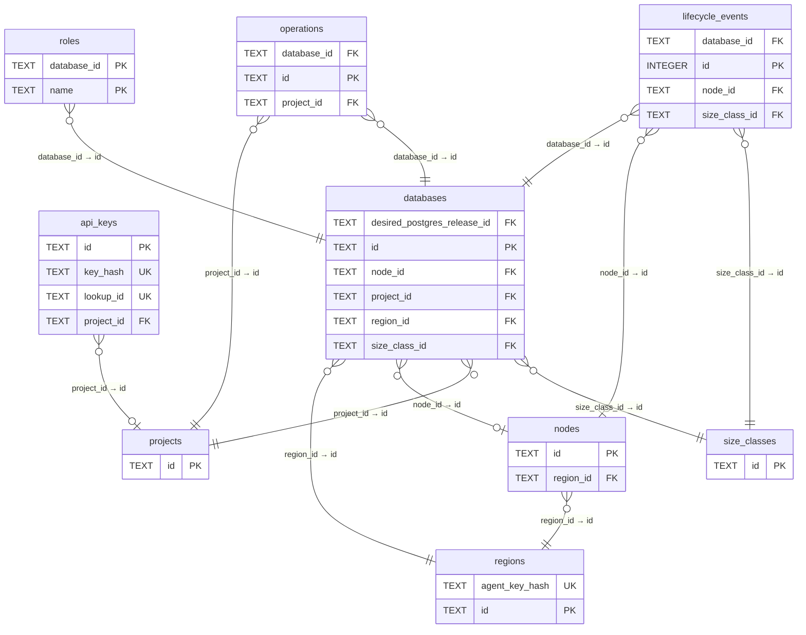

# Current D1 core tables and keys (selected view)

Generated by Mermaider. View: **implemented**. Basis: **declared source structure**.

This view is an explicitly selected subset of the source model.

## Sources

- [apps/api/migrations/0001_init.sql:1](../../../apps/api/migrations/0001_init.sql#L1)
- [apps/api/migrations/0002_node_cpu_capacity.sql:1](../../../apps/api/migrations/0002_node_cpu_capacity.sql#L1)
- [apps/api/migrations/0003_usage_metering.sql:1](../../../apps/api/migrations/0003_usage_metering.sql#L1)
- [apps/api/migrations/0004_actor_reconciliation.sql:1](../../../apps/api/migrations/0004_actor_reconciliation.sql#L1)
- [apps/api/migrations/0005_usage_rollup_progress.sql:1](../../../apps/api/migrations/0005_usage_rollup_progress.sql#L1)
- [apps/api/migrations/0006_resize_operations.sql:1](../../../apps/api/migrations/0006_resize_operations.sql#L1)
- [apps/api/migrations/0007_maintenance_credentials.sql:1](../../../apps/api/migrations/0007_maintenance_credentials.sql#L1)
- [apps/api/migrations/0008_database_lifecycle.sql:1](../../../apps/api/migrations/0008_database_lifecycle.sql#L1)
- [apps/api/migrations/0009_power_timeout_cursor.sql:1](../../../apps/api/migrations/0009_power_timeout_cursor.sql#L1)
- [apps/api/migrations/0010_infrastructure_costs.sql:1](../../../apps/api/migrations/0010_infrastructure_costs.sql#L1)
- [apps/api/migrations/0011_add_nodes.sql:1](../../../apps/api/migrations/0011_add_nodes.sql#L1)
- [apps/api/migrations/0012_region_bootstrap_credentials.sql:1](../../../apps/api/migrations/0012_region_bootstrap_credentials.sql#L1)
- [apps/api/migrations/0013_bootstrap_jobs.sql:1](../../../apps/api/migrations/0013_bootstrap_jobs.sql#L1)
- [apps/api/migrations/0014_node_network.sql:1](../../../apps/api/migrations/0014_node_network.sql#L1)
- [apps/api/migrations/0015_restore.sql:1](../../../apps/api/migrations/0015_restore.sql#L1)
- [apps/api/migrations/0016_node_health.sql:1](../../../apps/api/migrations/0016_node_health.sql#L1)
- [apps/api/migrations/0017_node_recovery.sql:1](../../../apps/api/migrations/0017_node_recovery.sql#L1)
- [apps/api/migrations/0018_ram_capacity.sql:1](../../../apps/api/migrations/0018_ram_capacity.sql#L1)
- [apps/api/migrations/0019_startup_admission.sql:1](../../../apps/api/migrations/0019_startup_admission.sql#L1)
- [apps/api/migrations/0020_node_installation.sql:1](../../../apps/api/migrations/0020_node_installation.sql#L1)
- [apps/api/migrations/0021_node_firewall_allocation.sql:1](../../../apps/api/migrations/0021_node_firewall_allocation.sql#L1)
- [apps/api/migrations/0022_bootstrap_network_authorization.sql:1](../../../apps/api/migrations/0022_bootstrap_network_authorization.sql#L1)
- [apps/api/migrations/0023_region_bootstrap_material_revision.sql:1](../../../apps/api/migrations/0023_region_bootstrap_material_revision.sql#L1)
- [apps/api/migrations/0024_cpu_request_policy.sql:1](../../../apps/api/migrations/0024_cpu_request_policy.sql#L1)
- [apps/api/migrations/0025_resource_profiles.sql:1](../../../apps/api/migrations/0025_resource_profiles.sql#L1)
- [apps/api/migrations/0026_fleet_release_state.sql:1](../../../apps/api/migrations/0026_fleet_release_state.sql#L1)
- [apps/api/migrations/0027_region_archive_sources.sql:1](../../../apps/api/migrations/0027_region_archive_sources.sql#L1)
- [apps/api/migrations/0028_node_storage.sql:1](../../../apps/api/migrations/0028_node_storage.sql#L1)
- [apps/api/migrations/0029_ram_purchase_authority.sql:1](../../../apps/api/migrations/0029_ram_purchase_authority.sql#L1)
- [apps/api/migrations/0030_infrastructure_alerts.sql:1](../../../apps/api/migrations/0030_infrastructure_alerts.sql#L1)
- [apps/api/migrations/0031_fleet_patch_operations.sql:1](../../../apps/api/migrations/0031_fleet_patch_operations.sql#L1)
- [apps/api/migrations/0032_compute_pool.sql:1](../../../apps/api/migrations/0032_compute_pool.sql#L1)
- [apps/api/migrations/0033_database_postgres_release.sql:1](../../../apps/api/migrations/0033_database_postgres_release.sql#L1)
- [apps/api/migrations/0034_thin_storage.sql:1](../../../apps/api/migrations/0034_thin_storage.sql#L1)
- [apps/api/migrations/0035_node_host_configuration.sql:1](../../../apps/api/migrations/0035_node_host_configuration.sql#L1)
- [apps/api/migrations/0036_warm_reclaim.sql:1](../../../apps/api/migrations/0036_warm_reclaim.sql#L1)
- [apps/api/migrations/0037_fleet_updates.sql:1](../../../apps/api/migrations/0037_fleet_updates.sql#L1)
- [apps/api/migrations/0038_generic_capacity_policy.sql:1](../../../apps/api/migrations/0038_generic_capacity_policy.sql#L1)
- [apps/api/migrations/0039_infrastructure_backups.sql:1](../../../apps/api/migrations/0039_infrastructure_backups.sql#L1)
- [apps/api/migrations/0040_fleet_rollout_intent.sql:1](../../../apps/api/migrations/0040_fleet_rollout_intent.sql#L1)
- [apps/api/migrations/0041_node_threshold_warnings.sql:1](../../../apps/api/migrations/0041_node_threshold_warnings.sql#L1)
- [apps/api/migrations/0042_thin_qualification.sql:1](../../../apps/api/migrations/0042_thin_qualification.sql#L1)
- [apps/api/migrations/0043_infrastructure_backup_attempts.sql:1](../../../apps/api/migrations/0043_infrastructure_backup_attempts.sql#L1)
- [apps/api/migrations/0044_fleet_patch_superseded.sql:1](../../../apps/api/migrations/0044_fleet_patch_superseded.sql#L1)
- [apps/api/migrations/0045_fleet_patch_confirmed_node.sql:1](../../../apps/api/migrations/0045_fleet_patch_confirmed_node.sql#L1)
- [apps/api/migrations/0046_thin_authority_renewal.sql:1](../../../apps/api/migrations/0046_thin_authority_renewal.sql#L1)
- [apps/api/migrations/0047_admission_snapshots.sql:1](../../../apps/api/migrations/0047_admission_snapshots.sql#L1)
- [apps/api/migrations/0048_postgres_pool.sql:1](../../../apps/api/migrations/0048_postgres_pool.sql#L1)
- [apps/api/migrations/0049_postgres_pool_qualification.sql:1](../../../apps/api/migrations/0049_postgres_pool_qualification.sql#L1)
- [apps/api/migrations/0050_pool_role_mutations.sql:1](../../../apps/api/migrations/0050_pool_role_mutations.sql#L1)
- [apps/api/migrations/0051_parked_tier.sql:1](../../../apps/api/migrations/0051_parked_tier.sql#L1)
- [apps/api/migrations/0052_infrastructure_backup_deferrals.sql:1](../../../apps/api/migrations/0052_infrastructure_backup_deferrals.sql#L1)
- [apps/api/migrations/0053_cron_heartbeat_and_alert_kinds.sql:1](../../../apps/api/migrations/0053_cron_heartbeat_and_alert_kinds.sql#L1)
- [apps/api/migrations/0054_role_lifecycle.sql:1](../../../apps/api/migrations/0054_role_lifecycle.sql#L1)
- [apps/api/migrations/0055_start_admission_attestation.sql:1](../../../apps/api/migrations/0055_start_admission_attestation.sql#L1)
- [apps/api/migrations/0056_drop_postgres_pool.sql:1](../../../apps/api/migrations/0056_drop_postgres_pool.sql#L1)
- [apps/api/migrations/0057_fleet_release_thin_facts.sql:1](../../../apps/api/migrations/0057_fleet_release_thin_facts.sql#L1)
- [apps/api/migrations/0058_drop_thin_headroom_samples.sql:1](../../../apps/api/migrations/0058_drop_thin_headroom_samples.sql#L1)
- [apps/api/migrations/0059_drop_parked_tier.sql:1](../../../apps/api/migrations/0059_drop_parked_tier.sql#L1)
- [apps/api/migrations/0060_drop_storage_protection.sql:1](../../../apps/api/migrations/0060_drop_storage_protection.sql#L1)
- [apps/api/migrations/0061_database_sleep_after.sql:1](../../../apps/api/migrations/0061_database_sleep_after.sql#L1)
- [apps/api/migrations/0062_drop_kubernetes_runtime.sql:1](../../../apps/api/migrations/0062_drop_kubernetes_runtime.sql#L1)

Freshness checks confirm the recorded source evidence and generated output. They do not establish live deployment or prove every semantic interpretation.
