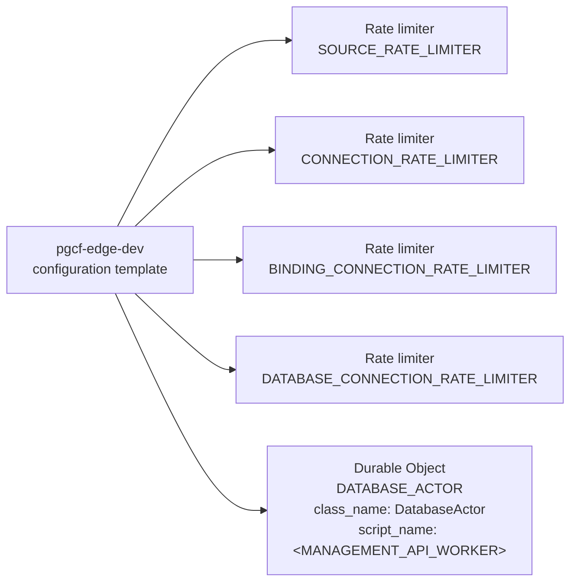

# TypeScript Edge: declared Cloudflare resources (template)

Generated by Mermaider. View: **implemented**. Basis: **declared source structure**.

## Coverage notes

- **wrangler-placeholder**: Resource at durable_objects.bindings.0 contains a placeholder; its deployed target is unknown.

## Sources

- [apps/edge/wrangler.example.jsonc:3](../../../apps/edge/wrangler.example.jsonc#L3)
- [apps/edge/wrangler.example.jsonc:19](../../../apps/edge/wrangler.example.jsonc#L19)
- [apps/edge/wrangler.example.jsonc:30](../../../apps/edge/wrangler.example.jsonc#L30)
- [apps/edge/wrangler.example.jsonc:41](../../../apps/edge/wrangler.example.jsonc#L41)
- [apps/edge/wrangler.example.jsonc:50](../../../apps/edge/wrangler.example.jsonc#L50)
- [apps/edge/wrangler.example.jsonc:59](../../../apps/edge/wrangler.example.jsonc#L59)

Freshness checks confirm the recorded source evidence and generated output. They do not establish live deployment or prove every semantic interpretation.
