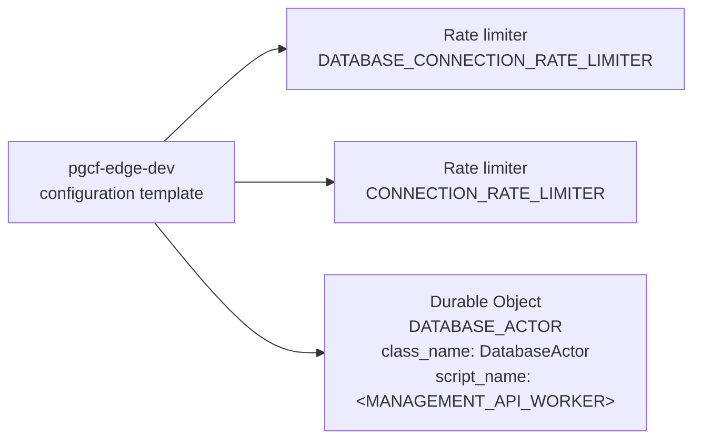

# TypeScript Edge: declared Cloudflare resources (template)

Generated by Mermaider. View: **implemented**. Basis: **declared source structure**.

## Coverage notes

- **wrangler-placeholder**: Resource at durable_objects.bindings.0 contains a placeholder; its deployed target is unknown.

## Sources

- [apps/edge/wrangler.example.jsonc:3](../../../apps/edge/wrangler.example.jsonc#L3)
- [apps/edge/wrangler.example.jsonc:17](../../../apps/edge/wrangler.example.jsonc#L17)
- [apps/edge/wrangler.example.jsonc:28](../../../apps/edge/wrangler.example.jsonc#L28)
- [apps/edge/wrangler.example.jsonc:37](../../../apps/edge/wrangler.example.jsonc#L37)

Freshness checks confirm the recorded source evidence and generated output. They do not establish live deployment or prove every semantic interpretation.
